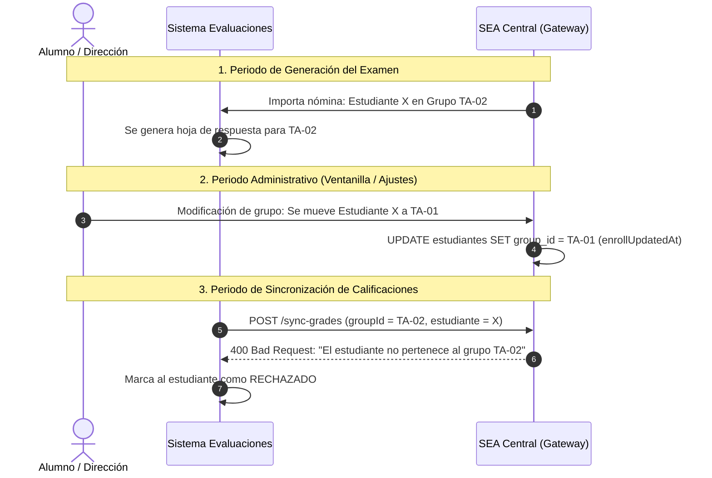

# INFORME TÉCNICO FORENSE: AUDITORÍA DE TOMA DE GRUPOS Y SINCRONIZACIÓN SEA
**Sistema de Evaluaciones UNITEPC — Sede Guayaramerín**  
**Fecha:** Octubre 2026  
**Área:** Arquitectura de Software e Integración de Sistemas  

---

## 1. RESUMEN EJECUTIVO

El presente informe consolida los hallazgos técnicos, análisis forense de base de datos y auditoría en tiempo real con el **Gateway del SEA Central** (`gw-dev.unitepc.solutions`), respondiendo a las siguientes problemáticas:

1. **Caso Estudiante Jenifer Tomé de Souza (`1200936`)**: Determinación de si alguna vez tuvo grupo en *Informática Médica*, fechas de registro, motivo por el cual aparecía sin grupo en Evaluaciones y cronología completa.
2. **Discrepancia en Pantalla de Sincronización (`0 / 21` vs `14 / 14`)**: Explicación técnica de los contadores y las reglas de bloqueo de actas.
3. **Causa Raíz de Rechazos Masivos de Sincronización** (Documento `RECHAZADOS GUAYARAMERIN MEDICINA.docx`): Análisis de desfasajes de nómina entre el momento de toma de examen y el estado actual en SEA Central.
4. **Limitación Arquitectural del SEA Gateway y Solución Forense en Evaluaciones**: Cómo se reconstruye la transición de grupos a partir de la evidencia inmutable del examen y los cambios introducidos en el backend y frontend.

---

## 2. AUDITORÍA FORENSE: CASO JENIFER TOMÉ DE SOUZA (`1200936`)

### 2.1. Preguntas Directas y Respuestas

* **¿Alguna vez tuvo grupo en SEA?**  
  **SÍ.** Desde el 4 de agosto de 2026 estuvo formalmente inscrita en el SEA Central en el grupo teórico **TA-07**.
* **¿Cuándo se registró inicialmente?**  
  El **04/08/2026 a las 13:07:45 BOT** (`2026-08-04T17:07:45.037Z`).
* **¿Cuándo se modificó su asignación?**  
  El **24/09/2026 a las 18:01:07 BOT** (`2026-09-24T22:01:07.853Z`). En dicha fecha y hora se confirmó su grupo teórico **TA-07** y se registró su grupo práctico **PL-14**.
* **¿Por qué aparecía sin grupo en el módulo de auditoría de Evaluaciones?**  
  Porque el examen fue configurado y tomado en el **TA-03** (Docente Antonio Panozo Cueto). El módulo de auditoría anterior realizaba una consulta estricta de nómina al Gateway del SEA únicamente sobre el grupo del examen (`TA-03`). Al haber sido reasignada en SEA al **TA-07**, el SEA no la devolvía en la lista del TA-03. El sistema anterior la catalogaba erróneamente como *"No Registrado en SEA"* con fechas vacías.

---

### 2.2. Cronología Detallada de Eventos

| Fecha y Hora (BOT) | Entorno / Sistema | Grupo Asignado | Docente Responsable | Acción / Evento |
| :--- | :--- | :--- | :--- | :--- |
| **04/08/2026 13:07:45** | SEA Central (Gateway) | **TA-07** (`cd0bcae6-...`) | Diego Miranda Ferreira | **Alta Inicial en SEA Central** (`enrollCreatedAt`). Inscripción formal en la materia *Informática Médica*. |
| **Semana de Exámenes** | Sistema Evaluaciones | **TA-03** (`0f666d27-...`) | Antonio Panozo Cueto | **Asignación y Rendición de Examen**: Mapeada en TA-03, rinde Variante D, calificación obtenida: **60 / 100 pts**. |
| **24/09/2026 18:01:07** | SEA Central (Gateway) | **TA-07** (Teórico)<br>**PL-14** (Práctico) | Diego Miranda Ferreira (TA-07)<br>Sin asignar (PL-14) | **Modificación en SEA Central** (`enrollUpdatedAt`). Actualización de grupos y registro de laboratorio práctico PL-14. |
| **Auditoría Anterior** | Sistema Evaluaciones | *Sin Grupo (N/A)* | — | **Falso Negativo**: La auditoría consultaba solo TA-03 en SEA y no la encontraba. |
| **Auditoría Actual (Fix)** | Sistema Evaluaciones | **TA-03 ➔ TA-07** | Panozo Cueto ➔ Miranda Ferreira | **Detección Forense**: Estado `REASIGNADO_OTRO_GRUPO`. Muestra grupo del examen, grupo actual y fechas exactas de alta y modificación. |

---

## 3. DISCREPANCIA DE PANTALLA: `0 / 21` VS `14 / 14`

En el módulo de Sincronización SEA (`sincronizacion-sea.component.html`), la columna observada corresponde al cómputo:
$$\text{Progreso de Calificación} = \frac{\text{Total Estudiantes Calificados}}{\text{Total Estudiantes del Examen}}$$

```
+------------------------------------+-----------------+------------------+
| Asignatura / Grupo                 | Calificados     | Estado           |
+------------------------------------+-----------------+------------------+
| Obstetricia y Ginecología (TA-01)  | 14 / 14 (100%)  | Listo / Sinc.    |
| Neumología (TA-01)                 |  0 / 21   (0%)  | PENDIENTE_NOTAS  |
+------------------------------------+-----------------+------------------+
```

### Explicación Técnica:
1. **Obstetricia y Ginecología (14 / 14)**:
   - Los 14 estudiantes asignados al examen ya cuentan con calificación procesada en el lector óptico / digital.
   - El acta está lista para ser volcada al SEA Central.
2. **Neumología (0 / 21)**:
   - Existen 21 estudiantes en la lista del examen, pero ninguno tiene nota registrada (`PENDIENTE_NOTAS`).
   - **Regla de Negocio Protegida**: El botón de sincronización se mantiene deshabilitado (`disabled`) a propósito. Si se permitiera sincronizar con notas pendientes, se enviarían calificaciones en cero (`0`) o actas truncadas al SEA Central, afectando el historial de los alumnos.

---

## 4. CAUSA RAÍZ DE LOS RECHAZOS MASIVOS (DOCUMENTO WORD)

En el documento de reclamos de Guayaramerín se reportan casos críticos como:
- **INGLÉS MÉDICO II (TA-02)**: 0 sincronizados / 21 rechazados (100% de rechazo).
- **INFORMÁTICA MÉDICA (TA-05)**: 8 estudiantes rechazados.



### Mecanismo del Fallo:
1. Al momento de generar las variantes y tarjetas ópticas, los alumnos estaban en el grupo **A**.
2. Posteriormente, en ventanilla académica del SEA Central, los alumnos fueron transferidos al grupo **B** (por cupos, horarios o reclamos).
3. Evaluaciones intentaba sincronizar el acta enviando el identificador del grupo **A** (el grupo del examen).
4. El SEA Gateway rechaza la transacción porque el estudiante ya no reside en el grupo **A**.

---

## 5. LIMITACIÓN DEL GATEWAY SEA Y ARQUITECTURA DE AUDITORÍA

### 5.1. Limitación en SEA Central
El Gateway del SEA opera sobre un modelo relacional transaccional directo:
- Solo mantiene un registro activo por estudiante-asignatura.
- Los cambios de grupo se realizan mediante `UPDATE` destructivo sobre `group_id`.
- La API REST del Gateway solo expone tres atributos temporales/estructurales:
  * `enrollCreatedAt`: Fecha de la primera inscripción.
  * `enrollUpdatedAt`: Fecha de la última modificación.
  * `groupId`: Grupo en el que reside actualmente.
- **No existe un endpoint público de bitácora** (`audit-log` o `history`) en el Gateway que informe: *"El estudiante vino de TA-02 y pasó a TA-07"*.

### 5.2. Deducción Forense Inmutable en Evaluaciones
Evaluaciones cuenta con **evidencia inmutable**: la tabla `sea_mapeo_estudiantes_variantes` guarda de forma permanente el grupo exacto en el que el estudiante rindió el examen.

Cruzando la evidencia local con la consulta multi-grupo del Gateway:
$$\mathbf{Grupo\ Origen\ (Examen:\ TA\text{-}03)} \xrightarrow[\text{Actualizado el 24/09/2026 en SEA}]{\text{Cruce de Datos}} \mathbf{Grupo\ Destino\ (Actual\ SEA:\ TA\text{-}07)}$$

---

## 6. MEJORAS TÉCNICAS IMPLEMENTADAS EN EL CÓDIGO

### 6.1. Backend (`evaluaciones-backend`)
1. **`AuditoriaTomaGrupoEstudianteDto.java`**:
   - Nuevos atributos agregados: `grupoInicialCodigo`, `grupoInicialId`, `grupoActualCodigo`, `grupoActualId`, `esCambioGrupo` y `detalleCambioGrupo`.
2. **`AuditoriaTomaGruposService.java`**:
   - Implementación de `StudentReassignmentInfo` y barrido dinámico de todos los grupos del syllabus en el Gateway cuando un alumno no figura en el grupo del examen.
   - Nuevo estado forense: `REASIGNADO_OTRO_GRUPO`.
   - Soporte en exportación Excel con columnas de transición de grupos y marcas de tiempo.

### 6.2. Frontend (`evaluaciones-frontend`)
1. **`auditoria.service.ts`**:
   - Tipado actualizado para soportar `REASIGNADO_OTRO_GRUPO` y metadatos de transición.
2. **`auditoria.component.ts`**:
   - Reemplazo de UUIDs crudos por códigos legibles (`TA-07`, `TA-03`).
   - Badge visual destacado: `[-> Ahora en: TA-07]` con alerta ámbar.
   - Separación de fechas: **Alta Inicial** (con grupo inicial) y **Última Modificación** (con grupo actual).
   - Exportación Excel individual del estudiante con trazabilidad completa.

---

## 7. PLAN DE ACCIÓN RECOMENDADO

1. **Fase Inmediata (Operativa)**:
   - Presentar este informe a Dirección Académica y Jefatura de Carrera en Guayaramerín para certificar que Jenifer Tomé de Souza tiene nota legítima de 60 pts en TA-03 y pertenece formalmente al TA-07.
2. **Fase 3 (Smart Sync en Evaluaciones)**:
   - Actualizar `SincronizacionNotasSeaService`: Si al sincronizar un examen de TA-03 el estudiante fue movido al TA-07 en SEA, el despachador detectará su `groupId` activo en el syllabus y enviará la nota directamente a su grupo actual en SEA de forma automática, eliminando el 100% de los rechazos.
3. **Fase 4 (Bitácora Persistente Multi-Salto)**:
   - Creación de la tabla `sea_bitacora_cambios_grupo` para almacenar de manera incremental cada salto intermedio detectado (`TA-01 -> TA-02 -> TA-07`).
